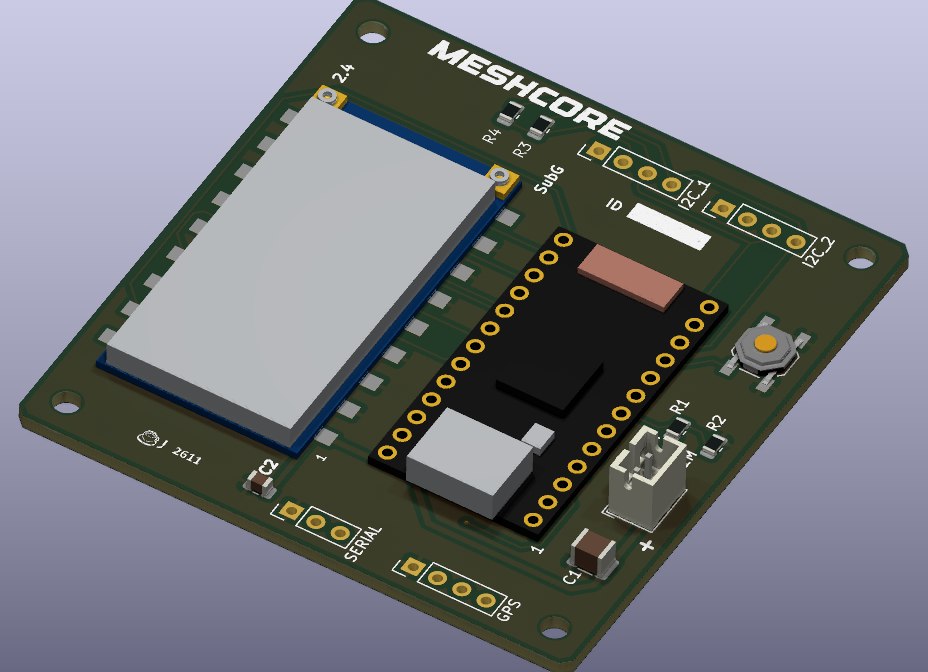

### ProMicro LR2021F33-2G4 PCB for Meshcore

Gerbers are in [Promicro_LR2021F33.zip](https://github.com/f3sty/ProMicro-LR2021F33-2G4/raw/refs/heads/main/Promicro_LR2021F33.zip)

##### Notes: 
Only fit R3/R4 if you're connecting one or more I2C devices and none of them have bus pull up resistors (most I2C modules do).
The LR2021 module is powered directly from the battery, not via the ProMicro USB-C socket.
